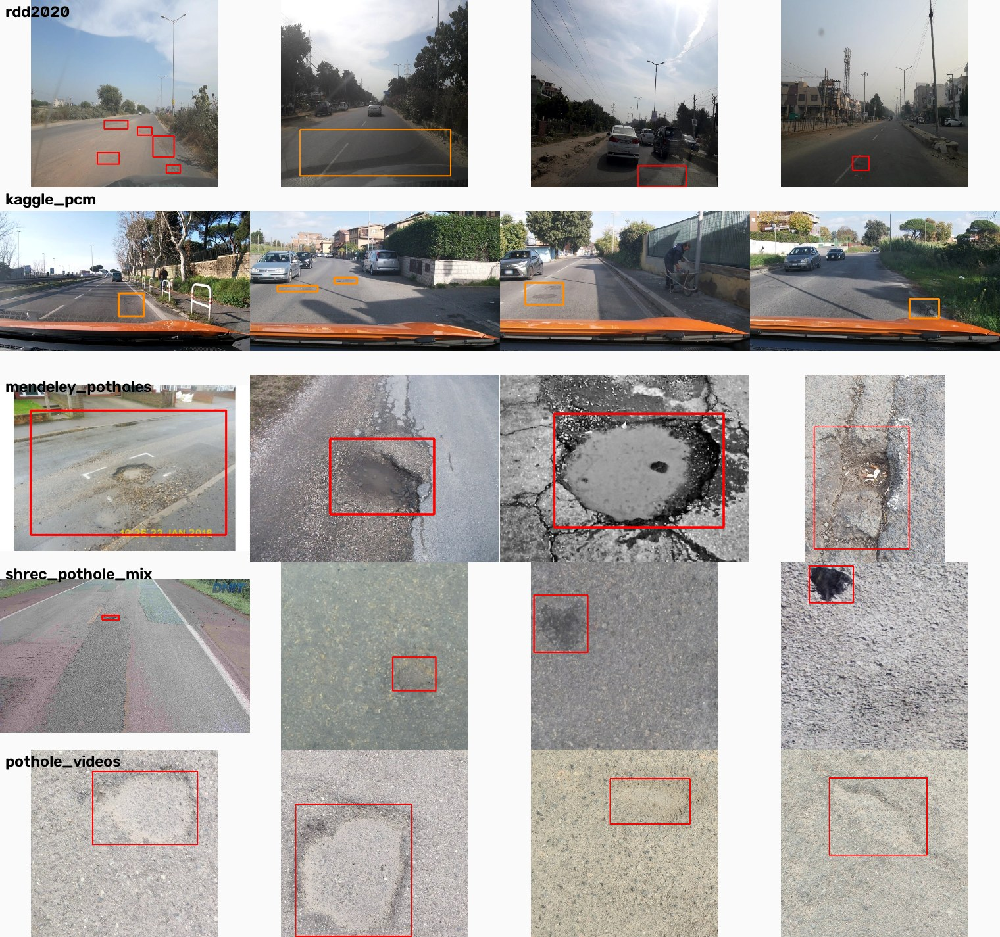
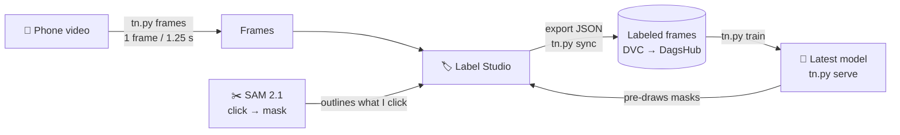

# 🛣️ RoadScan: spotting road damage on Tunisian streets

**A personal computer-vision project: a phone on the dashboard, a segmentation model, and every pothole, crack, open manhole and pile of trash outlined automatically.**


> **Where it stands (Sept 2026):** 425 hand-labeled frames of Tunisian streets, 5 classes, 1,578 polygon masks.
> Best model so far: **mask mAP50 0.30 to 0.34** on held-out frames, up from **0.08** when I started with public datasets.
> Built and trained on a 4 GB laptop GPU. It's still a work in progress, and this page is honest about what went wrong.

---

## Why

Roads in Tunisia wear out fast: potholes after the rain, cracked asphalt, manhole covers sunk below the road surface, and litter along the roadside. They're reported by hand, if at all.

The long-term idea is simple: **drive with a phone, and let a model flag the damage that matters**.

- **Stage 1 (now):** find and outline every anomaly in the video.
- **Stage 2 (later):** rate how *severe* each one is, so a report can say "3 dangerous potholes on this street", not "400 cracks".

| Class | What counts |
|---|---|
| 🕳️ pothole | holes and broken-out asphalt |
| ⚡ crack | longitudinal, transverse and alligator cracking |
| ⭕ manhole | covers, especially sunken or broken ones |
| 🗑️ trash | litter, bags, rubbish piles on the road or its edge |
| ❔ other | any other hazard: rubble, sand, broken curbs... |

---

## The story so far

### Chapter 1: "just use the public datasets" (it didn't work)

I started the way most tutorials do: collect every public road-damage dataset and train one detector.

- Unified **6 public sources** (RDD2020, Kaggle, Pothole Mix / SHREC 2022, two Mendeley sets, PathCare) into **17,663 images** with one class map, stable IDs and a split with no leakage between train and test (grouped by video and near-duplicate).
- Ran a full EDA and a **label audit** with confidence intervals. Findings: about **25% of Kaggle "cracks" are actually potholes**, and **35% of sampled RDD crack boxes show no visible damage**.
- Trained YOLO11s on Colab: **mAP50 0.546** on the public validation set.

Then I tested it on a video I recorded myself in Tunisia:

| Test data | mAP50 |
|---|---|
| Public validation set | 0.546 |
| Public dashcam images only | 0.446 |
| **My own street footage** | **0.081** 💥 |

The model had learned *other people's roads*: a different camera height, different light, different asphalt. It had even learned that manholes come with an orange car hood, because every manhole in the training data came from one Kaggle source. Fine-tuning on my own frames helped a bit (0.08 → 0.26), but it was a patch on the wrong foundation.

➡️ The full engineering log of this phase (dataset decisions, EDA, audit, runs A/B) is archived in [`docs/phase1_public_data.md`](docs/phase1_public_data.md).

<p align="center"><br>
<em>The public sources don't look like each other, or like a Tunisian street.</em></p>

### Chapter 2: Tunisian roads only, masks instead of boxes

So I started over:

- **Only my own footage.** 6 videos recorded around Tunisian streets, avenues and a suburban road.
- **Masks, not boxes.** A box around a diagonal crack is mostly clean road; a polygon traces the damage itself, which Stage 2 needs to measure severity.
- **Two new classes, trash and other**, because that's what's actually on these roads.
- **A human-in-the-loop labeling cycle**, so each model makes the next labeling round faster.

---

## How it works



1. **Extract frames** from a video (`tn.py frames`), one every 1.25 s so neighbouring frames aren't near-copies.
2. **Label in Label Studio.** The current model is connected live through a small backend I wrote (`tn.py serve`, standard library HTTP only). It pre-draws its guesses on every frame, so I mostly **delete wrong shapes and fix edges**.
3. **Click to segment.** For anything the model misses, one click (or a box) and **SAM 2.1** outlines the object.
4. **Sync and train** (`tn.py sync`, `tn.py train`): the export becomes YOLO segmentation labels, split **by time within each video** (the last 20% is held out, never shuffled randomly), and a new YOLO11s-seg is trained.
5. **Repeat.** Each round, the model draws better, so labeling gets faster.

Before my own model knew about trash, **YOLOE** (an open-vocabulary YOLO) found it from a text prompt ("garbage bag", "litter", ...). After one round my model beat it (7 of 9 trash objects found vs 4 of 9) and took over.

---

## Results

Each round was scored on that round's held-out frames (the last 20% of each video's labeled frames). As the dataset grows the held-out set changes, so **compare models within a round**, not across the whole table.

| Model | Labeled frames | What changed | Mask mAP50 | Precision | Recall |
|---|---|---|---|---|---|
| tn1 | 80 | first model, trash + other appear | 0.205 | 0.60 | 0.19 |
| tn2 | 198 | 2.5× the data | 0.205 | 0.37 | 0.17 |
| tn3 | 270 | epoch cap 60 + early stopping | 0.241 | 0.32 | 0.28 |
| tn5_hsv07 | ~330 | default colour jitter (saturation 0.7) | 0.259 | 0.29 | 0.34 |
| **tn5_hsv035** | ~330 | **half the saturation jitter (0.35)** | **0.335** | 0.53 | 0.34 |
| tn6_freeze | 425 | frozen backbone (first 10 layers) | 0.296 | 0.47 | 0.28 |
| tn6_initA | 425 | initialised from the phase 1 detector | 0.258 | 0.36 | 0.29 |
| tn6_initA_freeze | 425 | both | 0.202 | 0.24 | 0.26 |

What I take from it:

- **More Tunisian data beats clever tricks.** Starting from the public-data detector (tn6_initA) was *worse* than starting from generic COCO weights. The domain gap from chapter 1 shows up again.
- **Colour augmentation matters in harsh sun.** Halving the saturation jitter gave the biggest jump (0.259 → 0.335, one run each, so still to confirm).
- **Recall (about 0.3) is the bottleneck.** The model is fairly right when it speaks, but it still misses most small objects.

Label counts today: **other 699 · trash 338 · pothole 278 · manhole 139 · crack 124**.

---

## What went wrong (and what I learned)

| What happened | Why | What I changed |
|---|---|---|
| 0.55 on public data, **0.08** on my street | domain shift: camera, light, roads | dropped public data, labeled my own |
| Fine-tuned model called everything "manhole", even cars | too few frames repeated too often | fewer repeats + frozen backbone (then the fresh start) |
| Public labels were noisy (25% of Kaggle cracks are potholes) | annotators disagree, broad class definitions | measured it with a random audit instead of guessing |
| tn2 got worse after epoch 49 of 100 | memorising 160 frames | epoch cap + early stopping |
| **My laptop hard-crashed during training, twice** | GTX 1650 + CPU at full load on a laptop, probably heat/power | cached small image copies (less CPU), batch 2, or train on Kaggle/Colab |
| Label Studio refused to connect to my model | v1.23.1 blocks local model addresses by default | `ML_BLOCK_LOCAL_IP=false`, only for my local setup |
| No potholes at all in one held-out set | potholes cluster early in videos, and the held-out part is the end of each video | open issue: split so every class is represented |

---

## Challenges I'm working on

- 🔍 **Small objects.** Trash and distant manholes cover under 0.2% of the frame. Next experiments: crop the empty sky band, and train at a higher resolution.
- ⚖️ **"Other" is a catch-all.** It's the biggest class (699) but mixes rubble, sand and broken curbs. It will probably be split.
- ⚡ **Cracks are rare** (124) and thin, so they're the weakest class.
- 🧪 **Honest evaluation.** The held-out frames come from the same videos. The next step is a test set from a street the model has never seen.
- 💻 **Hardware.** 4 GB of VRAM and a laptop that crashes under long training runs.

## Where I'm heading

- [ ] A test set from an unseen street (video 20260920_122358)
- [ ] Error analysis: where in the frame the model fails, and on which class
- [ ] Crop and resolution experiments for small objects
- [ ] Stage 2: severity scoring from the masks (area, shape, position in the lane)
- [ ] A hosted labeling setup (Hugging Face Space or Cloudflare Tunnel, already prototyped in [`space/`](space/))
- [ ] A demo video, with faces and number plates blurred

**I'd love feedback** on small-object segmentation, on active-learning strategies (which frames to label next), and on how to evaluate honestly with a few hundred frames. Issues and suggestions are welcome.

---

## Tech stack

| Area | Tools |
|---|---|
| Models | Ultralytics **YOLO11s-seg**, **SAM 2.1** (tiny), **YOLOE** (open-vocabulary) |
| Labeling | **Label Studio** + a custom ML backend (`tn.py serve`) |
| Data | **DVC** with a private **DagsHub** remote, OpenCV, pandas |
| Phase 1 | FiftyOne, scikit-learn (`StratifiedGroupKFold`), perceptual hashing for near-duplicates |
| Compute | local GTX 1650 (4 GB), Google Colab T4 |

## Repo tour

```
src/tn.py                  the whole Tunisian pipeline:
                           frames | seed | sync | train | serve (Label Studio backend + SAM click-to-mask)
data/tn/label_config.xml   Label Studio config: polygons + smart click/box tools
space/                     Hugging Face Space prototype (Label Studio + model in one container)
data.md                    how every dataset is captured, labelled, split, and its known problems
docs/phase1_public_data.md phase 1 log: public-dataset unification, EDA, audit, runs A/B
src/convert_*.py, split.py, clean.py, eda_*.py, train.py, own_*.py   phase 1 scripts
reports/eda/               phase 1 EDA figures
```

## Run it

```powershell
uv venv .venv311 --python 3.11; .\.venv311\Scripts\Activate.ps1
uv pip install -r requirements.txt
dvc pull data/processed.dvc   # unified public dataset from DagsHub (3.1 GB)
dvc pull data/tn.dvc          # Tunisian mask dataset (201 MB)

# 1. frames from a video, pre-drawn by the current model
python src/tn.py frames --video my_drive.mp4 --weights runs/tn6_freeze/weights/best.pt

# 2. Label Studio + live model (two terminals)
$env:ML_BLOCK_LOCAL_IP="false"; $env:LABEL_STUDIO_LOCAL_FILES_SERVING_ENABLED="true"; $env:LABEL_STUDIO_LOCAL_FILES_DOCUMENT_ROOT="$PWD\data\tn"; uvx label-studio
python src/tn.py serve --weights runs/tn6_freeze/weights/best.pt   # connect at http://localhost:9090

# 3. export JSON from Label Studio, then
python src/tn.py sync --json export.json
python src/tn.py train --run tn7
```

## Data and privacy

My own footage shows **faces and number plates**, so it's never committed to Git and never published. Frames and labels are versioned with DVC in a **private** DagsHub remote. Any demo will be blurred first.

---

## Credits and licences

Phase 1 was built on public datasets. All credit for collecting and annotating them belongs to the original authors. Please cite them if you use this work.

- **RDD2020**: D. Arya, H. Maeda, S. K. Ghosh, D. Toshniwal, Y. Sekimoto, *RDD2020: An annotated image dataset for automatic road damage detection using deep learning*, Data in Brief, 2021, DOI [10.1016/j.dib.2021.107133](https://doi.org/10.1016/j.dib.2021.107133). Only the four official classes were used: D00 longitudinal crack, D10 transverse crack, D20 alligator crack, D40 pothole. Code and links: <https://github.com/sekilab/RoadDamageDetector>
- **Road Damage Dataset: Potholes, Cracks and Manholes** (Kaggle): <https://www.kaggle.com/datasets/lorenzoarcioni/road-damage-dataset-potholes-cracks-and-manholes>
- **Pothole Mix** (SHREC 2022 pothole and crack segmentation data): A. Ranieri, E. Moscoso Thompson, S. Biasotti, Mendeley Data, 15 Feb 2022, DOI [10.17632/kfth5g2xk3.1](https://doi.org/10.17632/kfth5g2xk3.1), licence CC BY 4.0. It was assembled from five public datasets, which must also be credited:
  - Crack500 and GAPs384 (Yang et al., *Feature Pyramid and Hierarchical Boosting Network for Pavement Crack Detection*, IEEE T-ITS 2019). GAPs384 is **academic use only**.
  - EdmCrack600 (Mei et al., Automation in Construction 2020). **Commercial use is not allowed.**
  - Pothole-600: <https://sites.google.com/view/pothole-600>
  - Cracks and Potholes in Road Images: <https://github.com/biankatpas/Cracks-and-Potholes-in-Road-Images-Dataset>
  - CNR Road Dataset
- **An Annotated Water-Filled, and Dry Potholes Dataset for Deep Learning Applications**: J. Dib, K. Sirlantzis, G. Howells, Mendeley Data, 2 Mar 2023, DOI [10.17632/tp95cdvgm8.1](https://doi.org/10.17632/tp95cdvgm8.1), CC BY 4.0.
- **Pothole Videos**: M. Ihsan, A. Harjoko, M. A. Amrizal, Mendeley Data, 25 Mar 2024, DOI [10.17632/5bwfg4v4cd.3](https://doi.org/10.17632/5bwfg4v4cd.3), CC BY 4.0.
- **PathCare: A Dataset for Road Fault Diagnosis**: B. Abro, S. Jatoi, M. Z. Shaikh, E. Nava Baro, B. S. Chowdhry, M. Milanova, Mendeley Data, 29 Oct 2024, DOI [10.17632/6p52w7d5xd.2](https://doi.org/10.17632/6p52w7d5xd.2), CC BY 4.0.
- Models: [Ultralytics YOLO11](https://github.com/ultralytics/ultralytics) (AGPL-3.0), [SAM 2](https://github.com/facebookresearch/sam2) (Apache 2.0), YOLOE via Ultralytics.

**Licence note:** some phase 1 sources restrict commercial use. This project is for personal and academic use.

---

<p align="center">Made in Tunisia 🇹🇳 by <a href="https://github.com/Botkraker">Yassine Ben Sassi</a>, final-year computer engineering student.</p>
